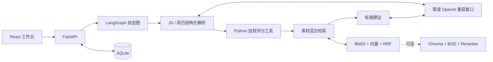

# 职启云帆 · 求职成长工作台 / JD–Resume Agent

面向 Python / Agent 求职的全栈作品：React 天蓝色求职成长工作台 + FastAPI / LangGraph 分析服务，覆盖真实经历整理、简历制作、岗位拆解、面试准备和投递跟进。


## 功能

- Agent 工作台：粘贴 JD 和简历，或上传文字 PDF / UTF-8 TXT。
- 六节点工作流：route → parse_jd → parse_resume → match → retrieve → advise，展示节点轨迹与耗时。
- 可解释评分：必须技能权重 3、加分技能权重 1，逐项列出技能、权重和原文证据。分数是技能覆盖率，不是录用概率。
- 技能别名：sklearn/scikit-learn、postgres/PostgreSQL；LangChain 与 LangGraph 不混同，Java 不匹配 JavaScript。
- 素材 RAG：真实经历素材、BM25 + 向量双路召回 + RRF、建议引用；没有依据只给学习计划。
- 最多 20 个 JD 批量排序，限制并发、单项失败隔离、CSV 导出。
- SQLite 持久化素材和分析历史，报告展示模型模式、警告、耗时和 Token。
- 今日驾驶舱：集中显示逾期、今天、未来任务、下一场面试和在途机会，帮助用户先做最重要的事。
- 机会漏斗：统一管理 BOSS、手动粘贴和 CSV 来源，支持新发现 → 已收藏 → 定制中 → 已投递 → 沟通中 → 面试中 → Offer 的手动状态流，并提供不适合/已关闭退出与撤销。
- BOSS 接入中心：通过本机 Docker 服务和 Chrome/Edge 扩展采集当前可见职位，进入 SQLite 收件箱后可加入机会漏斗或带入 JD 匹配；密钥仅保存在浏览器。详见 [BOSS 接入教程](docs/boss-integration.md)。
- 跟进与面试包：机会拥有默认下一步和提醒时间，可在跟进页完成或改期；岗位面试包由规则组装，无 AI 时仍可用。详见 [V1 求职闭环使用指南](docs/job-loop.md)。
- 页面级数据权限：简历页支持 PDF/TXT/DOCX 上传、粘贴核对、编辑与导出；机会页支持 CSV 导入/导出；跟进页支持投递记录导出。右上角数据设置只保留全局状态、API 配置和危险操作。
- 运行时业务 Skills：JD 拆解与诊断、真实经历简历定制、面试速学与预测练习题，结果按分析报告保存，详见 [业务技能](docs/business-skills.md)。
- 模板与提纲：16 种中文简历版式，覆盖校招、实习、社招、技术研发、产品运营、设计创意、管理咨询和学术科研 8 类人群；提供 10 类岗位内容框架、筛选、来源说明和 Markdown 提纲复制。[产品参考与原创资产](docs/product-references.md)。
- 全站采用天蓝色作品集风格和顶部导航；桌面与手机都通过编辑/预览标签切换。简历支持单页/双页页面容量、字体、字号、行距、页边距和主题色；外观设置随版本保存，字体、字号、行距、页边距与主题色同步到 DOCX 和浏览器 PDF，页面容量用于预览、质量估算与打印检查。
- 保留经历库、简历编辑、版本管理、ATS 友好结构、DOCX / 浏览器 PDF 导出、投递跟进、JSON 备份。模板切换不会覆盖已填写内容。原有 JD 匹配是浏览器规则功能，真实后端分析位于 Agent 工作台。

## 架构



这是确定性的 LangGraph 多步骤工作流，工具由节点显式调用，当前未声称自主规划或模型驱动的 Function Calling。

交付验证与已知限制见 [验证记录](docs/verification.md)，独立审查及修复证据见 [Superpowers 审计](docs/reviews/2026-11-18-superpowers-audit.md)。

| 模块 | 选型 | 原因 |
| --- | --- | --- |
| 前端 | React / TypeScript / Vite | 复用现有简历应用 |
| 后端 | Python 3.11+ / FastAPI / Pydantic | 异步 I/O、结构校验、OpenAPI |
| 编排 | LangGraph StateGraph | 清晰节点边界、可追踪降级 |
| 模型 | 智谱 OpenAI 兼容接口 | 服务端配置模型与密钥 |
| 默认检索 | BM25 + 稀疏向量余弦 + RRF | 无需下载模型，本地即可运行 |
| 可选检索 | Chroma / bge-small-zh-v1.5 / bge-reranker-base | 神经语义召回与交叉编码重排 |
| 存储 | SQLite / 本地 Chroma | 单用户持久化简单 |

## Windows 一键启动

需要 Python 3.11+、Node.js 22.12+、Git，首次安装联网。

```powershell
git clone https://github.com/MaLEVEL/Jian_li.git
cd Jian_li
Copy-Item .env.example .env
# 编辑根目录 .env；模型密钥在网页的“API 配置”中填写
powershell -ExecutionPolicy Bypass -File scripts/start.ps1
```

页面：http://127.0.0.1:18001 ，接口文档：http://127.0.0.1:18001/docs 。脚本安装后端、构建前端，由 FastAPI 同源提供页面。

开发模式：

```powershell
python -m venv .venv
.venv\Scripts\python.exe -m pip install -r backend/requirements-dev.txt
$env:PYTHONPATH = 'backend'
.venv\Scripts\python.exe -m uvicorn app.main:app --reload --host 127.0.0.1 --port 18001
# 另一个终端
cd frontend
npm.cmd ci
npm.cmd run dev
```

开发页面 http://localhost:5173 ，Vite 将 /api 代理到本地 18001 端口。Linux/macOS 使用 .venv/bin/python 执行对应命令。

## 智谱模型配置

推荐在网页顶部进入“BOSS 接入 → API 配置”，填写兼容 OpenAI Chat Completions 的请求地址、模型名和自己的密钥。默认请求地址为：

```text
https://open.bigmodel.cn/api/paas/v4/
```

模型名需使用你的账户可用型号，示例不承诺长期免费或可用。官方说明：https://docs.bigmodel.cn/cn/guide/develop/openai/introduction 。API Key 只保存在当前浏览器 localStorage；分析请求时临时放入发往本机后端的请求头，不写入 SQLite、JSON 备份、容器环境变量、日志或 Git。

根目录 `.env` 只保留端口、数据目录、检索模式和局域网绑定等部署参数，不需要也不会读取 `YUNFAN_API_KEY`。浏览器未配置完整的三项模型设置时，系统明确使用离线规则模式。上游超时、限流、无效 JSON 有限重试，401 不重试；失败呈现 degraded 与具体警告，不伪造成功。

## 可选 BGE 检索

```powershell
.venv\Scripts\python.exe -m pip install -r backend/requirements-rag.txt
# .env 修改 YUNFAN_RAG_MODE=bge 后重启
```

首次检索下载 BAAI/bge-small-zh-v1.5 和 BAAI/bge-reranker-base，需要额外网络、磁盘和内存。默认 Docker 使用 local 模式。依赖/模型不可用会给检索警告，不把稀疏向量声称为 BGE。

## Docker

```powershell
docker compose up --build -d
docker compose logs -f
docker compose down
```

页面仍为 http://127.0.0.1:18001 。Docker 命名卷保存素材和报告；down 保留数据，down -v 删除数据。端口默认只绑定本机。若 18001 被占用，可在 .env 设置其他 `YUNFAN_PORT`。可信局域网跨设备时同时设置 `YUNFAN_BIND_HOST=0.0.0.0` 与 `YUNFAN_ALLOWED_HOSTS=主机局域网IP或私有DNS名`，并且只通过该明确地址访问。Host 白名单禁止 `*`，不要直接暴露公网。脚本启动也可用 `scripts/start.ps1 -Port 18001`。

## API

| 方法 | 路径 | 用途 |
| --- | --- | --- |
| GET | /api/health | 实际模型和检索模式 |
| POST | /api/parse/resume | multipart file，PDF/TXT/DOCX，最大 2MB、20 页 |
| POST | /api/analyze | 单条分析 |
| POST | /api/batch | 1–20 个岗位分析排序 |
| POST | /api/batch/export | 批量分析与安全 CSV |
| GET/POST | /api/materials | 素材列表/新增 |
| GET/POST/DELETE | /api/boss/jobs | BOSS 职位池 |
| GET/PUT | /api/workspace | 单用户跨设备工作区同步 |
| POST | /api/provider/test | 临时测试浏览器配置的模型接口 |
| DELETE | /api/materials/{id} | 删除素材 |
| GET | /api/history | 最近 100 条报告 |
| GET | /api/history/{id} | 报告详情 |
| GET | /api/skills | 业务技能目录 |
| POST | /api/skills/{skill_id}/run | 基于 analysis_id 执行业务技能 |
| GET | /api/skill-runs | 指定分析的技能运行历史 |
| GET | /api/skill-runs/{id} | 技能结果详情 |

批量导出 API 和工作台的 CSV 导出都会重新执行分析，在线时可能再次消耗 Token。

## 测试与评估

```powershell
.venv\Scripts\python.exe -m pytest -q
.venv\Scripts\python.exe -m ruff check backend/app backend/tests backend/eval
$env:PYTHONPATH = 'backend'
.venv\Scripts\python.exe -m eval.run_eval --output docs/evaluation-report.json
cd frontend
npm.cmd test
npm.cmd run build
```

评估集为明确标记的合成回归数据，并非真实人工标注。实际数字及限制见 [评估方法](docs/evaluation-method.md) 和 [评估报告](docs/evaluation-report.json)。不要将规划中的 82%、68%→85%、<4s 等示例写成实测成绩。在线模型、BGE 与纯向量对比和费用必须在实际运行后报告。

## 目录

- backend/app：main.py 接口；graph.py 状态图；llm.py 客户端；schemas.py 校验；store.py SQLite；nodes 解析；tools 别名评分；rag 检索；prompts 节点提示。
- backend/eval：合成评估数据与 CLI；backend/tests：后端回归。
- frontend/src：原有简历应用和 Agent 工作台。
- docs：架构、规划、评估和面试说明；scripts：Windows 启动。
- archive/backend-legacy：历史参考，不参与默认运行。

## 演示与简历表达

1. 用真实经历生成/导入简历，进入 Agent 工作台。
2. 将真实经历添加到素材库，选择简历，粘贴目标岗位 JD。
3. 查看逐项评分、缺失技能、引用和工作流轨迹。
4. 批量排序多个岗位并导出 CSV，再从历史重开报告。

可写：基于 Python、FastAPI 与 LangGraph 构建 JD–Resume 分析工作流，完成结构化解析、可解释加权评分、素材混合检索与有据建议；复用 React 简历前端，支持最多 20 岗位批量排序、SQLite 历史、节点/Token 观测及 Docker。

这是本地单用户工具，尚无登录、多租户和公网访问控制。简历、投递和 BOSS 职位通过本机 SQLite 同步，浏览器 localStorage 保留离线副本；Host 与 Origin 白名单用于降低 DNS rebinding 和跨站写入风险。在线模式只把请求所需内容发往用户配置的模型服务。面试技术边界见 [面试说明](docs/interview-guide.md)。
