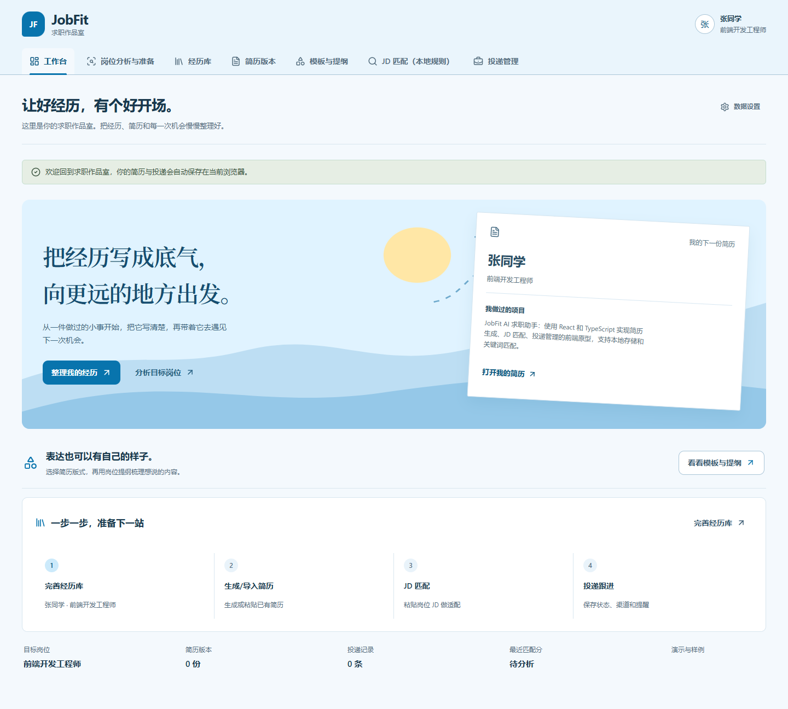
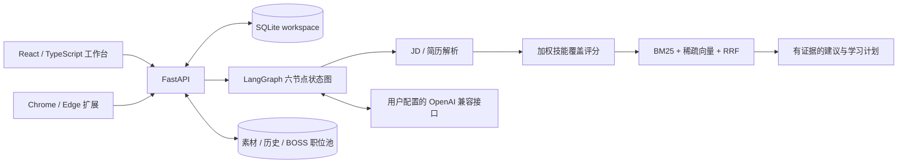

# 职启云帆 · 求职成长工作台

职启云帆是一个面向求职者的本地单用户工作台：整理真实经历、制作多版本简历、分析目标岗位、跟进投递，并为面试做准备。它也用于展示 React、Python、FastAPI 与 LangGraph 的全栈工程能力。



## 先看这里

第一次使用时，只需要记住三件事：

1. **真实资料**：经历、项目结果和联系方式由你自己维护；岗位框架、模板和 AI 只帮助组织，不会替你虚构履历。
2. **手动决定**：系统不会自动投递，也不会替你给招聘方发消息。所有阶段变化、发送和面试确认都由你完成。
3. **AI 可选**：未配置 AI 时仍可使用简历编辑、模板、本地 JD 匹配、机会管理和规则面试包；配置后，Agent 分析会获得模型增强。

### 按任务找文档

- 从机会到面试的完整操作：[V1 求职闭环](docs/job-loop.md)
- 安装 BOSS 浏览器扩展：[BOSS 接入教程](docs/boss-integration.md)
- JD 拆解、简历定制和面试准备：[业务 Skills](docs/business-skills.md)
- 模板来源与内置数据说明：[产品参考与原创模板](docs/product-references.md)

## 第一次启动

需要 Docker Desktop。没有安装时，先安装并启动 Docker Desktop。

```powershell
git clone https://github.com/MaLEVEL/Jian_li.git
cd Jian_li
Copy-Item .env.example .env
docker compose up -d --build
```

打开 **http://127.0.0.1:18001**。首次构建需要下载依赖；服务健康后即可使用。

## 完整使用流程

### 1. 完善经历库

进入顶部导航 **经历库**，填写真实的工作、项目、教育、技能和联系方式。每段项目尽量写清“背景、你的动作、使用的技术、可核对的结果”。

### 2. 创建或导入简历

进入 **简历版本**：

- 从经历库生成基础简历；
- 上传已有的 **PDF / UTF-8 TXT / 现代 .docx**，单个文件不超过 2 MB，PDF 最多 20 页且必须包含可提取文字；扫描版 PDF 需先 OCR；
- 或粘贴旧简历文本。

上传后先核对解析结果，再保存为新版本。同一工作区可以保留多份针对不同岗位的版本。

### 3. 调整版式与内容

进入 **模板与提纲**，按求职人群和目标岗位选择模板。系统内置 16 种简历版式和 10 类岗位内容框架。

在 **简历版本** 中还可以设置：

- 单页或双页；
- 字体、字号、行距、页边距和主题色；
- 可选简历照片，放在左上角或右上角，也可随时移除。

“编辑”和“预览”是两个标签页，手机和桌面都适用。模板只改变排版，不会覆盖已填内容。

### 4. 先整理机会，再判断是否投入

进入 **机会中心 → 机会漏斗**：

- 在“手动粘贴或 CSV 预览”中加入岗位；
- 从 **BOSS 职位收件箱** 把采集到的岗位加入漏斗；
- 使用“用 JD 匹配”“选择简历”“带入定制”继续处理；
- 用阶段按钮推进机会，用“安排跟进”记录下一次行动；
- 对不想再看的公司使用“拉黑公司”，需要时可打开黑名单并“恢复机会”。

阶段依次为：**新发现 → 已收藏 → 定制中 → 已投递 → 沟通中 → 面试中 → Offer**。也可以将机会退出为“不适合”或“已关闭”并撤销。

### 5. 分析岗位并准备面试

进入 **岗位分析与准备**，选择已有简历或上传文件，粘贴 JD 后运行分析。结果会展示：

- JD 与简历的结构化解析；
- 必须技能和加分技能的覆盖情况；
- 匹配证据、能力缺口和工作流耗时；
- 可追溯的真实素材引用；
- JD 拆解、简历定制和面试准备等业务 Skills。

分数表示技能覆盖率，不代表录用概率。生成内容必须人工核对，尤其是数字、年限、职责和技术掌握程度。

### 6. 跟进每一次机会

进入 **跟进** 查看投递记录和关联行动。首页 **今日** 会把未完成的下一步分为逾期、今天和未来；在跟进页可以完成、改期、查看关联简历，或为面试中的岗位打开面试包。

### 7. 需要时再配置 AI

点击页面右上角 **AI 服务配置**，填写：

- 服务商提供的 OpenAI 兼容 **请求地址**；
- 账户实际可用的 **模型名称**；
- 你的 **API Key**。

智谱默认地址为：

```text
https://open.bigmodel.cn/api/paas/v4
```

请求地址应填 API Base URL，不要包含 `/chat/completions`。配置只保存到当前浏览器，不会写入服务器数据库、项目 `.env`、日志或 Git。清除浏览器站点数据或换浏览器后需要重新填写。

## BOSS 岗位采集

BOSS 接入是可选项。它通过本机 Docker 服务和你主动安装的 Chrome/Edge 扩展，把当前页面已经显示的岗位带回本机职位收件箱。

浏览器扩展管理页中的“开发者模式”只是 Chrome 和 Edge 用来加载本地扩展的开关，不要求你会写代码。完整步骤见 [BOSS 接入教程](docs/boss-integration.md)。

扩展不会读取密码、聊天或 Cookie，不会翻页抓取，不会绕过登录和验证码，也不会自动投递。最终投递仍需你在 BOSS 页面确认。

## 导入、导出和数据放在哪里

系统已取消一个覆盖全平台的“数据设置”入口。导入导出按业务页面提供：

- **简历版本**：上传已有简历、下载 DOCX、通过浏览器打印为 PDF；
- **机会中心**：粘贴或 CSV 预览导入，并按当前筛选导出机会 CSV；
- **跟进**：按当前筛选导出投递记录 CSV。

数据保存位置：

| 数据 | 保存位置 |
| --- | --- |
| 经历、简历、照片、机会、筛选视图 | 本机 SQLite workspace，并在当前浏览器 localStorage 保留缓存 |
| BOSS 原始采集职位 | 本机 Docker 内 SQLite 职位池 |
| 素材与分析历史 | 本机 SQLite |
| AI 请求地址、模型名、API Key | 仅当前浏览器 localStorage |
| 下载的 DOCX、PDF、CSV | 浏览器下载目录 |

可在多台可信设备间同步 workspace，但当前没有账户与多人隔离，不应直接暴露到公网。

## 常见问题

### 没有 API Key 能否使用？

可以。系统会明确进入离线规则模式，规则分析、模板、简历编辑、机会和面试包仍可使用。

### 为什么导入后提示疑似重复？

只有规范化链接或平台岗位 ID 等强标识一致时才会自动合并。公司名、岗位名和城市相近只会提示可能存在重复，仍保留独立记录，避免误删不同岗位。

### 拉黑公司后去了哪里？

机会默认从漏斗、今日驾驶舱和提醒中隐藏。在机会页点“显示黑名单”查看原因，并可通过“恢复机会”整家公司恢复。

### 换电脑后为什么还要重新填 AI 配置？

API Key 被有意限制在当前浏览器，不会随 workspace 同步。

### 为什么下载的是 DOCX，不是直接生成 PDF？

DOCX 可继续编辑；PDF 通过浏览器打印窗口选择“另存为 PDF”。不同 Word/浏览器可能产生细微分页差异，导出前请检查最终文件。

---

# 开发者文档

## 系统架构



主分析是由节点显式调用工具的确定性 LangGraph 工作流，目前不声称自主规划、通用 Function Calling 或自动投递。

## 技术选型

| 模块 | 技术 | 作用 |
| --- | --- | --- |
| 前端 | React / TypeScript / Vite | 顶部导航工作台、简历编辑与导出、机会管理 |
| 后端 | Python 3.11+ / FastAPI / Pydantic | API、上传校验、结构校验、同源静态页面 |
| 工作流 | LangGraph StateGraph | route → parse_jd → parse_resume → match → retrieve → advise |
| 模型 | OpenAI Chat Completions 兼容接口 | 可选结构化解析与有据建议 |
| 检索 | BM25 + 稀疏向量余弦 + RRF | 默认无需模型下载的本地混合检索 |
| 可选检索 | Chroma / BGE / Reranker | 神经语义召回与交叉编码重排 |
| 持久化 | SQLite + 浏览器 localStorage | 单用户跨设备同步与离线缓存 |
| 采集 | Manifest V3 浏览器扩展 | 用户主动读取当前 BOSS 页面可见职位 |

## 本地开发

### Docker 运行

```powershell
Copy-Item .env.example .env
docker compose up -d --build
docker compose logs -f
docker compose down
```

- 页面：`http://127.0.0.1:18001`
- OpenAPI：`http://127.0.0.1:18001/docs`

`docker compose down` 保留命名卷数据；`docker compose down -v` 会删除容器数据卷。默认只监听 `127.0.0.1`。

### 分离开发

需要 Python 3.11+、Node.js 22+ 和 Git。

```powershell
python -m venv .venv
.venv\Scripts\python.exe -m pip install -r backend/requirements-dev.txt
$env:PYTHONPATH = 'backend'
.venv\Scripts\python.exe -m uvicorn app.main:app --reload --host 127.0.0.1 --port 18001
```

另一个终端：

```powershell
cd frontend
npm.cmd ci
npm.cmd run dev
```

Vite 开发页为 `http://localhost:5173`，`/api` 代理到本机 `18001`。

## 配置与安全边界

`.env` 只保存部署参数和默认兼容配置，不应放置用户 API Key。浏览器配置通过 `X-API-Base-URL`、`X-Model`、`X-API-Key` 在分析请求中临时传给本机后端；后端只把设置用于当次上游请求，不写入 SQLite、日志、workspace 或 Git。

关键变量：

| 变量 | 默认值 | 说明 |
| --- | --- | --- |
| `YUNFAN_BASE_URL` | `https://open.bigmodel.cn/api/paas/v4/` | 无浏览器覆盖时的默认 Base URL |
| `YUNFAN_MODEL` | `glm-4-flash` | 无浏览器覆盖时的默认模型 |
| `YUNFAN_LLM_MODE` | `auto` | 在线/离线模式控制 |
| `YUNFAN_TIMEOUT_SECONDS` | `60` | 上游超时 |
| `YUNFAN_MAX_RETRIES` | `2` | 可重试错误的最大重试次数；401 不重试 |
| `YUNFAN_RAG_MODE` | `local` | `local` 或 `bge` |
| `YUNFAN_BATCH_CONCURRENCY` | `2` | 批量分析并发上限 |
| `YUNFAN_PORT` | `18001` | 服务端口 |
| `YUNFAN_BIND_HOST` | `127.0.0.1` | 默认仅本机访问 |
| `YUNFAN_ALLOWED_HOSTS` | `127.0.0.1,localhost,::1` | Host 精确白名单，拒绝通配符 |
| `YUNFAN_CORS_ORIGINS` | Vite 与固定扩展 Origin | 精确 CORS 白名单 |

可信局域网跨设备使用时，同时设置 `YUNFAN_BIND_HOST=0.0.0.0`，并把实际访问的私有 IP 或私有 DNS 名加入 `YUNFAN_ALLOWED_HOSTS`。当前无账户认证、多租户隔离和公网防护，禁止直接暴露公网。

## 机会去重与黑名单契约

机会记录使用 `sourceKey`：

- `source-url:*`：规范化来源链接是第一优先强标识；
- `source-job:*`：平台名称 + 平台岗位 ID 是第二优先强标识；
- `job-identity:*`：只有公司、岗位、城市时形成弱身份键，用于提示疑似重复。

自动合并只在以下条件成立时发生：

1. 双方都有相同的强 `sourceKey`；或
2. 双方规范化 URL 相同；或
3. 双方来源平台与 `sourceJobId` 相同。

公司名、岗位名和城市相同但缺少强标识时，只返回疑似重复提示，不删除任何独立记录。合并时保留已有阶段、下一步、渠道、联系人和备注；JD、薪资、城市与来源快照按较新记录更新，旧记录缺失的联系信息才会补全。

黑名单是公司级字段：公司键使用规范化公司名；同公司记录共同显示、隐藏和恢复。黑名单机会从默认列表、今日任务和提醒中排除，不删除原记录。

## API

| 方法 | 路径 | 用途 |
| --- | --- | --- |
| GET | `/api/health` | 模型、检索与运行模式 |
| POST | `/api/parse/resume` | 解析 PDF/TXT/DOCX，最大 2 MB、20 页 |
| POST | `/api/analyze` | 单岗位分析 |
| POST | `/api/batch` | 1–20 个岗位批量分析排序 |
| POST | `/api/batch/export` | 重新执行批量分析并返回安全 CSV |
| GET / POST | `/api/materials` | 素材列表与新增 |
| DELETE | `/api/materials/{id}` | 删除素材 |
| GET | `/api/history` | 最近 100 条分析报告 |
| GET | `/api/history/{analysis_id}` | 报告详情 |
| GET | `/api/skills` | 受控业务 Skills 目录 |
| POST | `/api/skills/{skill_id}/run` | 基于已有分析运行技能 |
| GET | `/api/skill-runs?analysis_id=...` | 指定分析的技能运行历史 |
| GET | `/api/skill-runs/{run_id}` | 技能结果详情 |
| GET | `/api/workspace` | 读取单用户 workspace |
| PUT | `/api/workspace` | 乐观锁更新 workspace |
| GET | `/api/boss/health` | BOSS 导入服务状态 |
| POST | `/api/boss/jobs/import` | 扩展导入当前可见职位 |
| GET | `/api/boss/jobs?limit=...&offset=...` | 分页读取职位池 |
| GET | `/api/boss/jobs/{job_id}` | 职位详情 |
| DELETE | `/api/boss/jobs/{job_id}` | 删除本机职位池记录 |
| POST | `/api/provider/test` | 临时验证浏览器配置的模型接口 |

“岗位分析与准备”页的批量排名 CSV 和后端 `/api/batch/export` 会重新执行分析，在线时可能再次消耗 Token；机会中心和跟进页的本地 CSV 导出不会调用模型。

## 数据与冲突处理

- React 通过 `/api/workspace` 读取和写入单用户状态；`revision` 作为乐观锁。
- 发生 revision 冲突时，浏览器保留本地修改，并让用户在“保留本地并覆盖服务器”和“载入服务器版本”之间选择。
- provider settings 与 workspace 分离，故意不参与跨设备同步。
- 扩展只获得 `activeTab` 的临时页面权限，通过固定扩展 Origin 调用本机 BOSS API。
- 上传文件在请求层校验大小、页数与扩展名；DOCX 只接受现代 Office Open XML 结构。

## 可选 BGE 检索

```powershell
.venv\Scripts\python.exe -m pip install -r backend/requirements-rag.txt
# 在 .env 设置 YUNFAN_RAG_MODE=bge 后重启
```

首次使用会下载 `BAAI/bge-small-zh-v1.5` 与 `BAAI/bge-reranker-base`，需要额外网络、磁盘和内存。默认 Docker 使用 `local`。依赖或模型不可用时会显示检索警告，不会把稀疏向量冒充成 BGE。

## 测试与评估

```powershell
.venv\Scripts\python.exe -m pytest -q
.venv\Scripts\python.exe -m ruff check backend/app backend/tests backend/eval
$env:PYTHONPATH = 'backend'
.venv\Scripts\python.exe -m eval.run_eval --output docs/evaluation-report.json
cd frontend
npm.cmd test
npm.cmd run build
```

浏览器回归：

```powershell
cd frontend
npx playwright install chromium
$env:PLAYWRIGHT_BASE_URL = 'http://127.0.0.1:18001'
npm.cmd run test:e2e
```

评估集是明确标记的合成回归数据，不是招聘实验或人工标注。结果和方法见 [评估方法](docs/evaluation-method.md)、[评估报告](docs/evaluation-report.json) 与 [验证记录](docs/verification.md)。

## 目录

```text
backend/app/        FastAPI、LangGraph、解析、评分、检索、SQLite、业务 Skills
backend/tests/      后端回归测试
backend/eval/       合成离线评估集与 CLI
frontend/src/       React 工作台、简历、机会、跟进与 Agent UI
frontend/e2e/       Playwright 浏览器回归
extension/          Manifest V3 BOSS 页面采集扩展
docs/               用户教程、开发者说明、评估、面试与历史审查
scripts/            Windows 启动脚本
archive/            历史参考，不参与默认运行
```

## 相关文档

- [V1 求职闭环使用指南](docs/job-loop.md)
- [BOSS 接入教程](docs/boss-integration.md)
- [业务 Skills](docs/business-skills.md)
- [产品参考与原创模板](docs/product-references.md)
- [验证记录](docs/verification.md)
- [评估方法](docs/evaluation-method.md)
- [面试讲述与技术边界](docs/interview-guide.md)

## 简历中的准确表述

可写：

> 基于 React、TypeScript、Python、FastAPI 与 LangGraph 构建本地单用户求职工作台，完成 JD/简历结构化解析、加权技能覆盖评分、BM25/稀疏向量混合检索、有来源建议、SQLite workspace、浏览器扩展岗位导入和 Docker 交付；支持批量分析、机会去重/黑名单、页面级导入导出及业务 Skills。

不要写成已有公网多租户、真实招聘转化提升、自动投递、无人值守 Agent 或未经实测的性能承诺。
