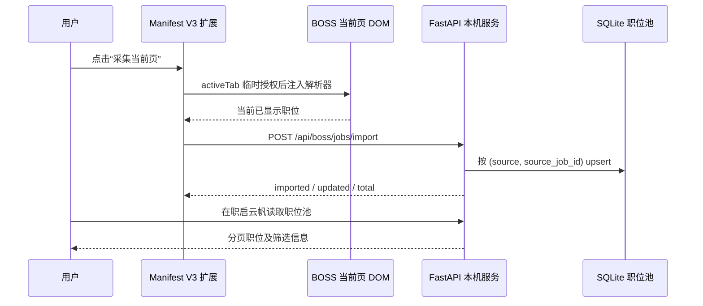

# BOSS 职位接入教程

BOSS 接入是一个“用户配置的本机或私有服务 + 浏览器扩展”的半自动流程：你在 BOSS 页面主动采集当前已经显示的职位，职位进入本机收件箱后，再到职启云帆里判断、匹配和跟进。

## 先看这里

- 这是可选项，不安装扩展也可以手动粘贴岗位或导入 CSV。
- 扩展只在 **你点击采集按钮** 后读取当前 BOSS 标签页中已经显示的职位。
- 扩展不读取密码、聊天、Cookie 或其他标签页，不翻页、不滚动、不点击岗位。
- 系统不绕过登录、验证码和 BOSS 风控，不自动投递，也不自动发送招呼语。
- 最终检查简历、填写招呼语和点击投递仍由你在 BOSS 页面完成。

## 第一次使用

### 第 1 步：启动职启云帆

在项目根目录运行：

```powershell
Copy-Item .env.example .env
docker compose up -d --build
```

打开 `http://127.0.0.1:18001`，确认页面可以正常使用。

### 第 2 步：安装浏览器扩展

Chrome 和 Edge 的操作基本一致：

1. Chrome 打开 `chrome://extensions`；Edge 打开 `edge://extensions`。
2. 打开右上角或左侧的 **开发者模式**。这个开关只允许浏览器加载本地扩展，不要求你会编程。
3. 点击 **加载已解压的扩展程序**。
4. 选择项目根目录下的 `extension` 文件夹。
5. 建议将“职启云帆 BOSS 职位采集器”固定到浏览器工具栏。

扩展默认连接 `http://127.0.0.1:18001`。如果本机端口改变了，在扩展弹窗里修改服务地址，并先点 **测试连接**。

### 第 3 步：按需要配置 AI

点击职启云帆页面右上角 **AI 服务配置**，填写：

- 请求地址，例如 `https://open.bigmodel.cn/api/paas/v4`；
- 服务商账户实际可用的模型名；
- API Key。

请求地址不要包含 `/chat/completions`。AI 配置只保存在当前浏览器，浏览器扩展本身不需要模型密钥。没有配置时仍能采集岗位、管理机会和使用离线规则分析。

### 第 4 步：从 BOSS 采集当前页

1. 登录自己的 BOSS 账号。
2. 打开职位搜索结果页，或打开一个职位详情页。
3. 等职位卡片、右侧详情或描述加载完成。
4. 点击工具栏中的职启云帆采集器。
5. 点击 **测试连接**，确认本机服务可用。
6. 点击 **采集当前页**。
7. 查看处理结果中的“处理总数”“新增”“更新”。

安装步骤和采集按钮也可以在职启云帆的 **机会中心 → 接入说明** 中查看。

### 第 5 步：回到职启云帆处理岗位

进入 **机会中心 → BOSS 职位收件箱**：

- **加入机会漏斗**：保存为可管理机会；
- **用这份 JD 匹配**：将公司、岗位和 JD 带入分析流程；
- **回到 BOSS**：打开原始职位页面；
- **删除**：删除本机收件箱记录，不影响 BOSS 页面。

“加入机会漏斗”不会自动投递，也不会改 BOSS 页面状态。

### 第 6 步：在 BOSS 上人工确认

准备投递时，重新打开原始岗位，检查：

- 简历版本和附件是否正确；
- 招呼语是否真实、具体、没有捏造经历；
- 目标公司和岗位是否与当前机会一致；
- 是否愿意提交当前联系方式。

只有你点击 BOSS 页面上的发送或投递按钮后，机会才真正完成投递；之后回到职启云帆手动推进到“已投递”。

## 采集不到职位怎么办

- **连接失败**：确认 Docker 服务运行，打开 `http://127.0.0.1:18001/api/boss/health` 检查。
- **职位池为空**：确认 BOSS 页面已经有可见职位卡片或详情，再重新点击“采集当前页”。
- **只采集到部分字段**：BOSS 页面结构和 A/B 测试会变化；打开职位详情并等待内容加载后重新采集。
- **出现登录、验证码或风控页**：按 BOSS 页面提示手动处理；本项目不会绕过。
- **AI 测试失败**：检查 Base URL、模型名、密钥、网络和 OpenAI Chat Completions 兼容性。
- **换端口后无法采集**：同步修改扩展弹窗中的服务地址，再测试连接。

## 跨设备使用

默认只允许本机访问。若要在可信局域网内从另一台电脑打开职启云帆，可在 `.env` 设置：

```dotenv
YUNFAN_BIND_HOST=0.0.0.0
YUNFAN_ALLOWED_HOSTS=127.0.0.1,localhost,::1,192.168.1.20
```

其中 `192.168.1.20` 替换成实际访问所用 IP 或私有 DNS 名。随后通过该明确地址访问，例如 `http://192.168.1.20:18001`。

当前没有账户认证与多人隔离。不要把服务绑定到公网，也不要把 `YUNFAN_ALLOWED_HOSTS` 改成通配符。

---

# 开发者文档

## 组件与数据流



## 扩展安装与固定 ID

`extension/manifest.json` 使用 Manifest V3 并包含固定公钥，扩展 ID 为：

```text
jdacbgmhcbpkoccblehfahhoekjiiopl
```

后端默认允许该精确 Origin：

```text
chrome-extension://jdacbgmhcbpkoccblehfahhoekjiiopl
```

移动扩展目录不需要重新配置 CORS。如果修改扩展公钥导致 ID 改变，必须把新的完整 Origin 加入 `YUNFAN_CORS_ORIGINS` 并重启服务。不要添加 `*`。

## 权限模型

- `activeTab`：仅在用户点击扩展图标后临时允许访问当前活动标签页；
- `scripting`：向当前标签页注入受控 DOM 解析器；
- `storage`：保存用户配置的本机服务地址；
- 默认 `host_permissions`：仅 `http://127.0.0.1/*` 与 `http://localhost/*`。

用户输入 RFC1918 局域网、`.local` 或 Tailscale 范围地址时，扩展会在明确操作后请求该 host 的可选权限；公网地址被拒绝。扩展没有 BOSS 站点的长期 host 权限。

## 解析边界

解析器限制在职位卡片和职位详情语义容器内，并排除脚本、聊天和消息区域。详情页必须找到可见且可靠的职位详情语义容器；找不到时返回空结果，不回退扫描整份 `document`。

采集字段：

```text
source_job_id, source_url, company, title, location, salary,
experience, education, description, recruiter_name,
recruiter_title, tags, fetched_at
```

当前不自动翻页、不滚动、不点击职位、不读取虚拟列表未渲染的内容，也不处理登录墙或验证码。

## 服务端接口

| 方法 | 路径 | 说明 |
| --- | --- | --- |
| GET | `/api/boss/health` | 服务状态与职位总数 |
| POST | `/api/boss/jobs/import` | 导入 1–50 个职位，返回 `{ imported, updated, total }` |
| GET | `/api/boss/jobs?limit=50&offset=0` | 分页读取；默认 50、最大 200，响应头含 `X-Total-Count`、`X-Limit`、`X-Offset` |
| GET | `/api/boss/jobs/{id}` | 读取一个职位 |
| DELETE | `/api/boss/jobs/{id}` | 删除本机职位池记录 |
| POST | `/api/provider/test` | 用临时 AI 配置测试兼容接口 |

服务端正式响应字段只有 `imported`、`updated`、`total`。浏览器扩展为了兼容旧服务，会额外读取 `processed` 和 `created` 别名；这些别名不是当前服务端契约。

- 扩展的“处理总数”优先读取服务端 `total`；旧服务的 `processed` 仅作兼容。
- 扩展的“新增”优先读取 `imported`；旧服务的 `created` 仅作兼容。
- “更新”读取服务端正式字段 `updated`。

扩展缺少某个统计字段时显示“未知”，不会把处理总数误标成成功导入数。

## 去重与存储

BOSS 职位池的唯一键是 `(source, source_job_id)`；`source_url` 会校验并保存，但不作为职位池去重键。重复导入同一来源岗位会更新已有记录，不重复创建。职位池保存在 Docker 命名卷中的 SQLite；容器停止不会删除数据，`docker compose down -v` 会删除数据卷。

“加入机会漏斗”把职位转换为 workspace 中的 `OpportunityRecord`，此后由机会级 `sourceUrl` / `sourceJobId` 强标识参与去重。职位池记录和机会记录是两套数据，删除职位池不会自动删除已加入的机会。

## 网络与 Host 安全

- 服务默认绑定 `127.0.0.1`；
- CORS 使用精确 Origin，不接受通配符；
- Host 白名单用于降低 DNS rebinding 和错误 Host 写入风险；
- 跨设备只允许可信私有网络上的明确地址；
- 当前无用户认证、授权、租户隔离和公网 TLS 方案。

## AI 配置请求契约

前端把 AI 服务配置保存在当前浏览器的 localStorage，键名为：

```text
jobfit-provider-settings-v1
```

请求 Agent、Skills 或 `/api/provider/test` 时使用三个必需请求头：

```text
X-API-Key
X-API-Base-URL
X-Model
```

三项必须同时提供或同时省略；部分配置返回 422。API Key 和三项请求头只会发送给受信任的职启云帆服务端；服务端随后按用户填写的 OpenAI 兼容地址访问外部模型服务，因此智谱等服务商的接口地址可以是公网地址。前端会阻止把职启云帆服务端地址配置为非本机、非私有局域网、非 `.local` 或非 Tailscale 的地址。后端把配置保存在请求级对象中，只用于当次上游请求，不写入 SQLite、workspace、Compose 配置或 Git；应用日志不记录请求头。

localStorage 是浏览器站点数据，不是加密保险箱。共享浏览器、站点 XSS 或浏览器配置被复制时仍有泄露风险，使用后应清理站点数据。

## 测试

扩展解析器：

```powershell
cd extension
npm.cmd test
```

后端 BOSS 与 workspace：

```powershell
.venv\Scripts\python.exe -m pytest backend/tests/test_boss_jobs.py backend/tests/test_workspace.py -q
```

浏览器端建议覆盖：

1. 开启/关闭本机服务时的状态；
2. 采集成功后职位池刷新与分页；
3. “加入机会漏斗”和“用这份 JD 匹配”的跳转；
4. 删除职位池记录后机会记录仍存在；
5. 手机宽度和键盘焦点可用。
